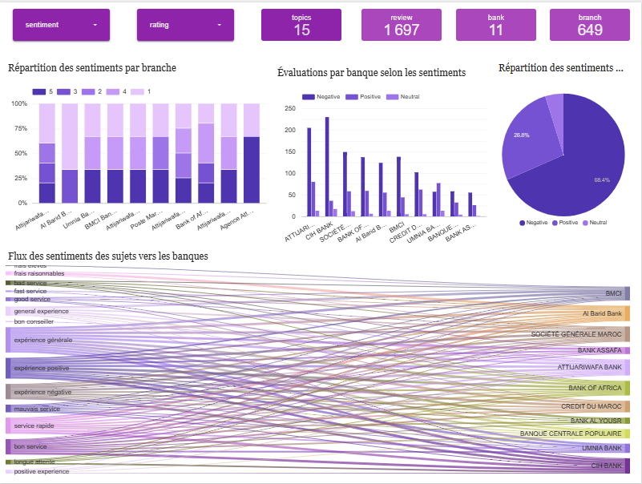
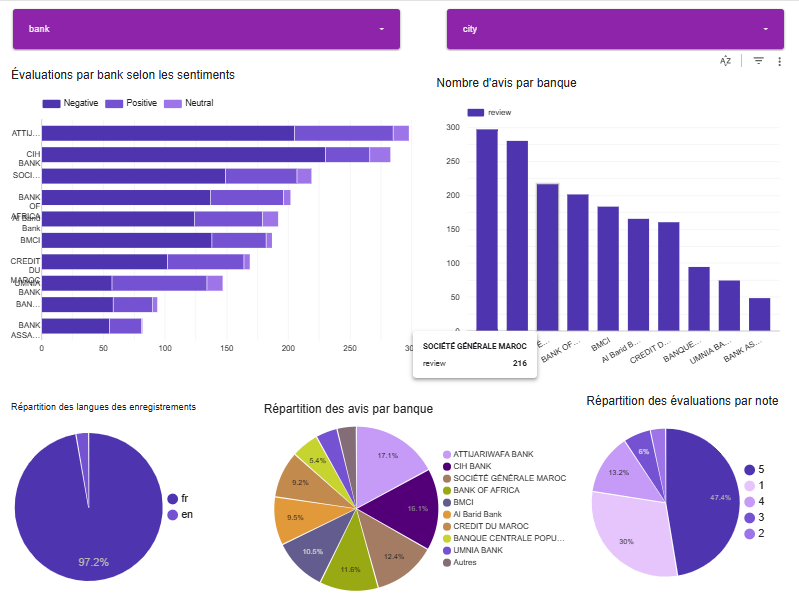
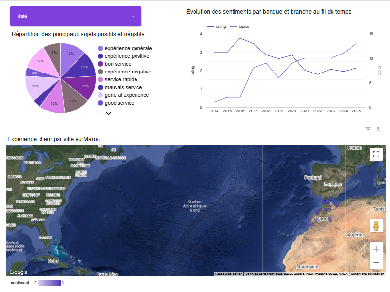
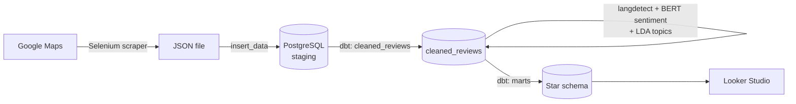

# Moroccan Bank Reviews Analytics

A data pipeline that collects Google Maps reviews of Moroccan bank branches, adds sentiment and language with NLP, models the result as a star schema in PostgreSQL with dbt, and feeds Looker Studio dashboards.

> **Data not included.** The scraped reviews are not part of this repository. The figures below are the ones shown on the dashboards built from our collection.

## Dashboards

Built in [Looker Studio](https://lookerstudio.google.com/reporting/1cda3e6d-9eba-4f49-ac0b-132287895caf/page/CXBNF) on top of the star schema. On our dataset they show **1,697 reviews**, **11 banks** and **649 branches**.





## Pipeline



One Airflow DAG, `Google_map` ([airflow/dags/google_map_dag_etl.py](airflow/dags/google_map_dag_etl.py)), runs five tasks in order. It has no schedule and is triggered manually.

| # | Task | What it does | Code |
|---|---|---|---|
| 1 | `extract_data_task` | Searches Google Maps for each bank in Morocco, opens every branch, scrolls the reviews and saves text, rating and relative date to a JSON file. Selenium (headless Chrome) + BeautifulSoup. | [main_programme_of_scraping.py](airflow/dags/Google_map_dags/main_programme_of_scraping.py) |
| 2 | `insert_data_task` | Loads the JSON into a `staging` table with psycopg2, then renames the file. | [insert_data.py](airflow/dags/Google_map_dags/insert_data.py) |
| 3 | `transform_phase_1_task` | dbt model `cleaned_reviews`: lowercases and strips punctuation, parses the 1–5 rating, removes duplicates and converts French relative dates ("il y a 2 ans") to a year. | [cleaned_reviews.sql](my_projects_dbt/datawarehouse_project/models/cleaned_reviews.sql) |
| 4 | `transform_phase_2_task` | Detects the language (`langdetect`), classifies sentiment with `nlptown/bert-base-multilingual-uncased-sentiment` (1–2 stars → Negative, 3 → Neutral, 4–5 → Positive) and writes both back for reviews in en, fr, de, es, it and nl. Also runs an LDA topic model (gensim, 5 topics). | [transform_phase_2.py](airflow/dags/Google_map_dags/transform_phase_2.py), [sentiment_model.py](airflow/dags/Google_map_dags/sentiment_model.py) |
| 5 | `load_phase_task` | dbt models for the star schema in the `Decisionnelle` schema: `fact_reviews` with `dim_bank`, `dim_branch`, `dim_location` and `dim_sentiment`. Primary and foreign keys are added with post-hooks. | [models/marts/](my_projects_dbt/datawarehouse_project/models/marts) |

`load_phase_1.py` is an older standalone script that creates the same star tables by hand. The DAG does not use it.

## Tech stack

- **Scraping:** Selenium, webdriver-manager, BeautifulSoup
- **Orchestration:** Apache Airflow 2.8.1
- **Storage:** PostgreSQL
- **NLP:** Hugging Face Transformers (multilingual BERT sentiment), langdetect, NLTK, gensim (LDA)
- **Modeling:** dbt-core 1.8.7 with dbt-postgres
- **BI:** Looker Studio

## Setup

> Not verified during the last cleanup: the full pipeline (scraping, Airflow and dbt) was not run again. The steps below describe what the code expects.

The code expects Linux or WSL: Chrome at `/usr/bin/google-chrome-stable`, a dbt virtual environment at `~/dbt_venv`, the dbt project at `~/my_projects_dbt/datawarehouse_project` and the JSON output in `~/input/data_of_json_google_map/`.

1. Create a PostgreSQL database and export its connection settings (see [.env.example](.env.example)): `POSTGRES_HOST`, `POSTGRES_PORT`, `POSTGRES_DB`, `POSTGRES_USER` and `POSTGRES_PASSWORD`.
2. Airflow environment (Python 3.8 originally): `pip install -r requirements.txt`, using Airflow's constraints file.
3. dbt environment in `~/dbt_venv`: `pip install -r requirements-dbt.txt`. Copy [.dbt/profiles.yml.example](.dbt/profiles.yml.example) to `~/.dbt/profiles.yml`.
4. Put the `airflow/dags/` folder in your Airflow DAGs folder and trigger the `Google_map` DAG.

## Repository layout

```
airflow/dags/
  google_map_dag_etl.py        Airflow DAG (5 tasks)
  Google_map_dags/             Scraper, loader, NLP step, sentiment model
my_projects_dbt/datawarehouse_project/
  models/cleaned_reviews.sql   Cleaning model
  models/marts/                Star schema (fact + 4 dimensions)
  macros/                      Relative-date conversion, primary keys
dashboards/                    Looker Studio screenshots
```

## Limitations

- **Scraper bank list.** In the committed code, only "Attijariwafa Bank" is active; the other banks are commented out. Our dataset was collected with more banks enabled.
- **Fragile scraping.** It relies on Google Maps CSS class names, which change often. Check Google's terms of service before running it.
- **Approximate dates.** Review dates are relative ("il y a 3 mois") and only converted to a year.
- **Sentiment.** The labels come from a model trained on product reviews with 1–5 stars, mapped to three classes. They were not evaluated on bank reviews. Reviews in other languages (Arabic, for example) get no sentiment and are left out of `fact_reviews`.
- **Topics.** The LDA topics are only written to the logs, not stored. The topic labels shown on the dashboards (for example "frais élevés" or "bon service") are not produced by code in this repository.
- **Slow DAG parsing.** `sentiment_model.py` runs a test prediction on import, so the BERT model loads whenever Airflow parses the DAG.
- **Schemas.** The mart models read `public.cleaned_reviews` directly instead of using `ref()`, so `cleaned_reviews` must be built in the `public` schema.
- **Local setup only.** Paths are hard-coded for one Linux/WSL setup. The project has no automated tests.

## Team

Built as a two-person project.

Reda Ikarnade · [GitHub](https://github.com/redax255) · [LinkedIn](https://www.linkedin.com/in/reda-ikarnade)

## License

[Apache 2.0](LICENSE)
